  

  

**I turn complex ideas into dependable products.**

[Portfolio ↗](https://vaibhavmasaye.com/) &nbsp; / &nbsp; [Case studies ↗](https://vaibhavmasaye.com/work) &nbsp; / &nbsp; [LinkedIn ↗](https://www.linkedin.com/in/vaibhavmasaye/) &nbsp; / &nbsp; [Get in touch ↗](mailto:masayevaibhav@gmail.com)

 

### 01 &nbsp; / &nbsp; ABOUT

## Engineering with product thinking.

I’m a **Senior Full Stack Developer at Dignisys**, based in Mumbai. For **5 years**, I’ve worked across web interfaces, backend services, mobile apps, and cloud delivery. I like understanding the problem first, designing systems that stay understandable, and owning the details through release.

My day-to-day spans **React, Next.js, Java, Spring Boot, Node.js, AWS, and Docker**. I’m open to **senior full-stack and backend roles** in Mumbai or remote.

 

### 02 &nbsp; / &nbsp; SELECTED WORK

## Work worth opening.

<table>
<tr>
<td width="50%" valign="top">

<h3><a href="https://vaibhavmasaye.com/work/inertia">Inertia ↗</a></h3>

<strong>Full stack · Design systems</strong> Market research platform spanning surveys, quotas, suppliers, and project operations. Led design-system work and delivered key backend features at Atomos Technologies.

<code>React</code> <code>TypeScript</code> <code>Node.js</code>
</td>
<td width="50%" valign="top">

<h3><a href="https://vaibhavmasaye.com/work/atomos-website">Atomos Technologies ↗</a></h3>

<strong>Frontend · Performance</strong> Led the company website build with responsive interfaces, search visibility foundations, and a focus on performance.

<code>Next.js</code> <code>TypeScript</code> <code>Tailwind</code>
</td>
</tr>
<tr>
<td width="50%" valign="top">

<h3><a href="https://vaibhavmasaye.com/work/certbot-service">Certbot Service ↗</a></h3>

<strong>Backend · Infrastructure</strong> Automates certificate issuance and renewal in Dockerized environments to make SSL operations repeatable.

<code>Node.js</code> <code>TypeScript</code> <code>Docker</code>
</td>
<td width="50%" valign="top">
<h3><a href="https://vaibhavmasaye.com/work/secure-file-upload-service">Secure File Upload Service ↗</a></h3>

<strong>Backend · Asynchronous processing</strong> Authenticated uploads with PostgreSQL metadata and Redis-backed workers. Separates API requests from file processing jobs.

<code>NestJS</code> <code>PostgreSQL</code> <code>Redis</code> <code>BullMQ</code>
  
<h3><a href="https://vaibhavmasaye.com/work/storage-system">Storage System ↗</a></h3>

<strong>Backend · API design</strong> API-first storage service organized around MVC and containerized deployment.

<code>Node.js</code> <code>Docker</code>
</td>
</tr>
</table>

**Also:** [Good Designers — product strategy, UX/UI and architecture planning ↗](https://vaibhavmasaye.com/work/gooddesigners) &nbsp;·&nbsp; [View all six case studies ↗](https://vaibhavmasaye.com/work)

 

### 03 &nbsp; / &nbsp; TOOLKIT

## Tools for the whole product.

| Focus | Tools |
| :--- | :--- |
| **Interfaces** | React · Next.js · TypeScript · Tailwind CSS · Angular |
| **Services** | Java · Spring Boot · Node.js · Express · NestJS |
| **Data** | MongoDB · PostgreSQL · MySQL · Redis |
| **Delivery** | AWS · Docker · Vercel · Git · CI/CD |
| **Mobile** | Android · iOS · Flutter |

 

### 04 &nbsp; / &nbsp; NEXT

## Let’s make something useful.

I’m interested in teams that care about thoughtful architecture, good product decisions, and reliable delivery.

[**Email me ↗**](mailto:masayevaibhav@gmail.com) &nbsp;&nbsp; [**Read my résumé ↗**](https://vaibhavmasaye.com/Vaibhav_Masaye_Resume.pdf) &nbsp;&nbsp; [**Explore my portfolio ↗**](https://vaibhavmasaye.com/)

Built around real work. More details and context live on the portfolio.
