  

<strong>Senior Full-Stack Developer at Dignisys</strong> · Mumbai, India

<a href="#experience">Experience</a> · <a href="#selected-work">Selected work</a> · <a href="#how-i-work">How I work</a> · <a href="#tech-stack">Tech stack</a>

---

## About me

<table>
<tr>
<td width="72%" valign="middle">

I’m Vaibhav, a senior full-stack developer with <strong>5 years of experience</strong> across web applications, backend services, mobile apps, and cloud delivery.

My work spans React and Next.js interfaces, Java and Spring Boot microservices, Node.js APIs, AWS deployments, and mobile applications. I’m based in Mumbai and open to senior full-stack and backend roles in Mumbai or remote.

<strong>5 years building software · 10+ projects shipped · 6 published case studies</strong>

<a href="https://vaibhavmasaye.com/#about">More about me ↗</a>

</td>
<td width="28%" valign="middle">

</td>
</tr>
</table>

---

## Experience

| Role | Period | What I owned |
| :--- | :--- | :--- |
| **Senior Full-Stack Developer · Dignisys** | Sep 2025–Present | Build full-stack products and software infrastructure, from system architecture and APIs through production delivery. |
| **Freelance Designer & Developer · Good Designers Co.** | Jun–Sep 2025 | Contributed product strategy, UX/UI design, and architecture planning for a creator portfolio and case-study platform. |
| **Software Developer Engineer II · Atomos Technologies** | Apr–Jun 2025 | Took broader ownership of full-stack delivery, DevOps workflows, architecture decisions, and production reliability. |
| **Full-Stack Software Developer Engineer · Atomos Technologies** | Jul 2023–Apr 2025 | Led development of Inertia, working across frontend and backend architecture, services, and the shared design system. |
| **Assistant Software Developer Engineer · Atomos Technologies** | Aug 2022–Jul 2023 | Delivered customer-facing features across frontend and backend systems, working with React and GCP. |
| **Full-Stack Engineer Intern · Traversia Technology** | Dec 2021–May 2022 | Built REST APIs and full-stack features using Spring Boot, Angular, and MySQL. |
| **Web Developer Intern · WINACLE Consulting** | Jun–Nov 2020 | Built web interfaces and gained hands-on frontend development experience. |

[View the career timeline on my portfolio ↗](https://vaibhavmasaye.com/)

---

## Selected work

<table>
<tr>
<td width="50%" valign="top">

<h3><a href="https://vaibhavmasaye.com/work/inertia">Inertia ↗</a></h3>

<strong>Full stack · Market research</strong>

Survey setup, quota management, supplier coordination, and reconciliation were handled through separate workflows. Inertia brings them together in one platform.

I led the design system and owned key backend deliverables. The case study covers reusable multilingual questions, multi-level quotas, test and live logs, and reconciliation by supplier.

</td>
<td width="50%" valign="top">

<h3><a href="https://vaibhavmasaye.com/work/atomos-website">Atomos Technologies ↗</a></h3>

<strong>Frontend · Company website</strong>

I led the website from planning to release. I built reusable UI patterns and responsive layouts so the team could extend the site consistently.

I also implemented the SEO foundations, including semantic page structure, crawl-friendly routes, canonical URLs, and social sharing metadata.

</td>
</tr>
<tr>
<td width="50%" valign="top">

<h3><a href="https://vaibhavmasaye.com/work/certbot-service">Certbot Service ↗</a></h3>

<strong>Backend · Deployment automation</strong>

I built a Node.js and TypeScript service that automates Let’s Encrypt certificate issuance and renewal for Dockerized deployments.

The service runs with Docker Compose, persists certificates in shared volumes across container restarts, and can integrate with Nginx. The case study includes architecture and sequence diagrams for provisioning and proxy configuration.

</td>
<td width="50%" valign="top">

<h3><a href="https://vaibhavmasaye.com/work/gooddesigners">Good Designers ↗</a></h3>

<strong>Product design · Architecture planning</strong>

I designed workflows for creators publishing long-form case studies and sharing work under confidentiality restrictions.

The concept includes a block editor, a single-image publishing option, and a project drawer for password-protected links and team invites. My contribution covered product strategy, UX/UI, and technical planning.

</td>
</tr>
</table>

### [Secure File Upload Service ↗](https://vaibhavmasaye.com/work/secure-file-upload-service)

A NestJS service that separates file ingestion from background processing. The API authenticates requests with JWT, validates uploads, writes file metadata to PostgreSQL, and queues work through BullMQ and Redis. Workers process files independently and update their status in PostgreSQL. That separation lets the upload API respond promptly while workers handle retries and scale independently.

### [Storage System ↗](https://vaibhavmasaye.com/work/storage-system)

I built an API-first storage backend that multiple clients can use. The MVC structure gives routing, storage workflows, and persistence distinct responsibilities as the API grows. The project uses Docker for consistent local environments and documents Docker Compose and Vercel serverless deployment options.

[Browse the complete case-study collection ↗](https://vaibhavmasaye.com/work)

---

## How I work

| Stage | What I focus on |
| :--- | :--- |
| **Understand** | Clarify who uses the software, what they need to accomplish, and where the current workflow breaks down. |
| **Design** | Define API boundaries, data models, and deployment constraints early. Make the important trade-offs visible to the team. |
| **Build** | Deliver in increments. Use shared UI patterns, code reviews, and clear ownership to keep changes understandable. |
| **Release** | Carry the work through CI/CD and production monitoring. Think through what operators need to diagnose and recover from failures. |

## Tech stack

| Area | Tools | Where I use them |
| :--- | :--- | :--- |
| **Frontend** | React · Next.js · TypeScript · Angular · Tailwind CSS | Responsive web applications, reusable UI components, and design systems. |
| **Backend** | Java · Spring Boot · Node.js · Express · NestJS | REST APIs, microservices, and asynchronous processing. |
| **Data and storage** | MongoDB · PostgreSQL · MySQL · Redis | Data modeling, persistence, caching, and background job state. |
| **Cloud and delivery** | AWS · GCP · Docker · Vercel · Git · CI/CD | Containerized deployments, release workflows, and production operations. |
| **Mobile** | Android · iOS · Flutter | Native and cross-platform mobile applications. |

---

## Connect with me

I’m open to senior full-stack and backend engineering roles in Mumbai or remote.

[**Portfolio ↗**](https://vaibhavmasaye.com/) · [**Résumé ↗**](https://vaibhavmasaye.com/Vaibhav_Masaye_Resume.pdf) · [**LinkedIn ↗**](https://www.linkedin.com/in/vaibhavmasaye/) · [**Email**](mailto:masayevaibhav@gmail.com)
